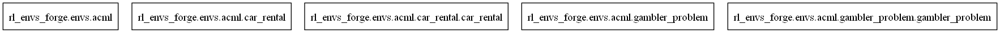
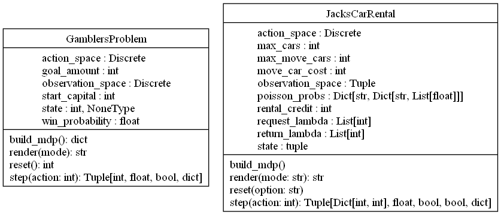

# ACML environments

This package contains Jack's Car Rental and the Gambler's Problem from
Sutton and Barto's *Reinforcement Learning: An Introduction* (2nd edition),
published in the Adaptive Computation and Machine Learning series.

Both environments support sampling with `step()` and provide `build_mdp()`
helpers for inspecting the problem structure.

## Jack's Car Rental

Move cars between two rental locations before the day's rental requests and
returns arrive. The reward is rental income minus the cost of moving cars.
Requests and returns follow Poisson distributions, with a separate rate for
each location.

```python
from rl_envs_forge.envs.acml.car_rental.car_rental import JacksCarRental

env = JacksCarRental(
    max_cars=10,
    max_move_cars=3,
    request_lambda=[2, 2],
    return_lambda=[2, 2],
)
state, info = env.reset(seed=0, options={"option": "equal"})
assert state == (5, 5)

# Action indices encode a signed number of cars to move.
cars_to_move = 2
action = cars_to_move + env.max_move_cars
state, reward, terminated, truncated, info = env.step(action)
```

The state is `(cars_at_A, cars_at_B)`. Action indices run from zero to
`2 * max_move_cars`. Subtract `max_move_cars` to get the signed transfer:
positive moves cars from A to B, negative from B to A, and zero leaves them
in place. With the settings above, action `3` means no transfer.

Transfers are clipped by the overnight limit, the cars available at the source,
and the free capacity at the destination. Only cars actually transferred incur
a movement charge. Moving into a full location, or moving from an empty one,
therefore moves no cars and costs nothing. Transfers conserve inventory.

The day proceeds in this order: transfer cars, fulfill rental requests from the
available stock, then accept returns up to each location's remaining capacity.
Each location always holds between zero and `max_cars` cars. Requests above the
available stock generate no additional rentals or income.

`reset(option="equal")` splits the initial inventory evenly using
`max_cars // 2` at each location. `reset(option="random")`, the default,
samples each location's inventory. You can pass the same choice through
`options`, as in the example. A seed controls both inventory sampling and
subsequent requests and returns.

Use a positive integer `max_cars`, a nonnegative integer `max_move_cars`, and
two finite nonnegative rates in each of `request_lambda` and `return_lambda`.
Use finite rental credits and movement costs. The complete planning model
validates the Poisson rates; neither interface validates every parameter up
front.

This is a continuing task: `step()` returns both ending flags as `False`.
Choose a horizon in your experiment. `rental_credit` and `move_car_cost`
control the reward. `poisson_max_value` sets how many Poisson probabilities
are precomputed in the legacy point-probability table. It does not truncate the
simulator or either planning API.

## Gambler's Problem

Choose a stake and try to reach `goal_amount` before losing all capital.
The observation is the current capital, and the action is the stake.

```python
from rl_envs_forge.envs.acml.gambler_problem.gambler_problem import GamblersProblem

env = GamblersProblem(goal_amount=100, win_probability=0.4, start_capital=10)
capital, info = env.reset(seed=0)

for _ in range(1000):
    stake = min(capital, env.goal_amount - capital)
    capital, reward, terminated, truncated, info = env.step(stake)
    if terminated or truncated:
        break
```

Reaching the goal pays one; all other outcomes pay zero. The episode terminates
at zero capital or the goal. Keep stakes between one and
`min(capital, goal_amount - capital)` for the textbook problem: the declared
action space is broader and does not enforce this state-dependent bound.

`env.feasible_actions()` returns the textbook stakes at the current capital;
pass a capital value to inspect another state. `env.action_mask()` returns a
fresh boolean mask over the fixed global action space. The helper and mask
include exactly the stakes represented by `build_mdp()`. Neither includes zero
stakes, and terminal states have no feasible stakes.

For example, at capital 2 with a goal of 5, feasible stakes are `(1, 2)`, while
the global action space still contains `0` through `5`. By default, `step()`
accepts zero stakes and overbets. Set
`strict_actions=True` to raise `ValueError` for a state-infeasible stake before
consuming randomness or changing capital. In that mode, select actions using
the mask; unmasked sampling from the global space can choose an invalid stake.

`reset()` returns to `start_capital`. Pass a seed to repeat the sequence of
bet outcomes.

Use a positive integer goal, integer starting capital between zero and the
goal, and a finite winning probability in `[0,1]`. These are caller
preconditions; the constructor does not currently check every one of them.

## Planning and inspection

The Gambler's Problem provides win and loss outcomes with probabilities for
each valid state and stake.

For Jack's Car Rental, use `build_transition_model()` for stochastic planning:

```python
# Build a model without changing the environment's inventory.
car_env = JacksCarRental(max_cars=10, max_move_cars=3)
model = car_env.build_transition_model()
state, action = (5, 5), car_env.max_move_cars  # No overnight transfer.
outcomes = model[(state, action)]
expected_daily_reward = model.expected_reward(state, action)
assert abs(sum(outcome[3] for outcome in outcomes) - 1) < 1e-12
```

The model maps `(state, action_index)` to an immutable tuple of
`(next_state, conditional_expected_reward, False, probability)` outcomes.
Action indices match `step()`. The reward is the expected daily reward given
that destination, including the actual transfer cost; it may be fractional even
when sampled rewards are integers. Weight these rewards by their probabilities
to recover `expected_daily_reward`. The model describes all next-state
probabilities and conditional mean rewards, rather than the distribution of
individual rental revenues.

All request counts at least as large as the available inventory are combined
into the saturated rental event. Likewise, return counts that fill the remaining
capacity are combined into the full-location event. These events include the
entire Poisson tail, including for zero rates; the model does not discard and
renormalize a finite prefix.

The model snapshots its parameters without changing inventory or consuming
random draws. Changing the environment afterward does not change that snapshot;
build a new model to reflect new parameters. It stores small per-location tables
and computes transition rows on demand. At capacity `C` and `K` actions, building
the model takes `O(C^3)` time and `O(C^2)` memory; querying one row takes `O(C^2)`
time and space. Iterating its keys is lazy. Materializing all rows would require
`O(K*C^4)` space, so keep the default 20-car model lazy.

`build_mdp()` remains available with its original signed-transfer keys and
`(representative_next_state, expected_reward, False)` values. Its representative
state is the inventory after the feasible transfer, corresponding to no requests
or returns. The expected reward now includes all saturated request tails and
actual movement costs. This helper retains its approximation of the next state;
use the complete model when a planner needs transition probabilities. Neither
helper requires `poisson_max_value >= max_cars`.

Reseeding still repeats sampled days. The request and return draw order is
unchanged, and feasible transfers retain their existing seeded results. Inventory
and reward trajectories change when a request is clipped by source inventory or
destination capacity, because movement charges now use the executed transfer
and destinations cannot temporarily overflow.

Use `env.render()` to print the state, or `env.render(mode="ansi")` to get a
string. The examples in the [algorithm repository](https://github.com/mariusdgm/phd-rl-algos)
show how these environments can be used with planning algorithms.

## Diagrams



