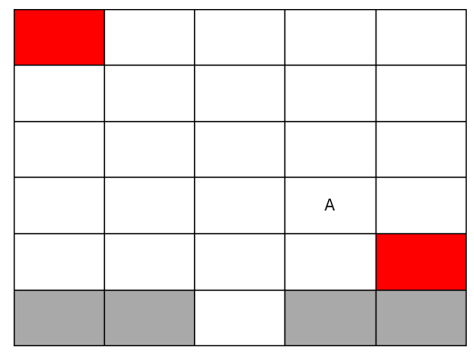
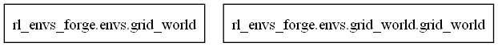
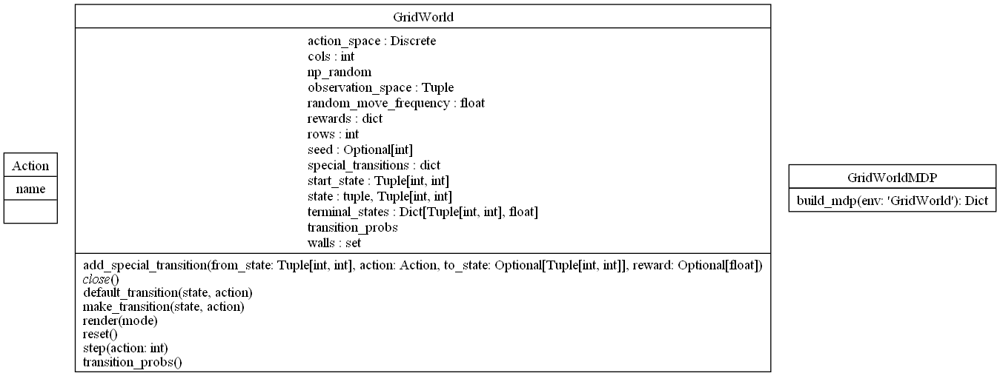

# GridWorld

GridWorld is a grid navigation environment with walls, terminal cells, and
optional jumps between cells. You can use deterministic movement or add
slippage to make actions uncertain.

## Getting started

```python
from rl_envs_forge.envs.grid_world.grid_world import Action, GridWorld

env = GridWorld(
    rows=6,
    cols=5,
    walls={(5, 0), (5, 1), (5, 3), (5, 4)},
    start_state=(1, 1),
    terminal_states={(0, 0): 1.0, (4, 4): 1.0},
)
state, info = env.reset(seed=0)
state, reward, terminated, truncated, info = env.step(Action.RIGHT)
env.render()
```

States are `(row, column)` tuples, starting at `(0, 0)` in the upper left.
Actions are `Action.UP` (`0`), `RIGHT` (`1`), `DOWN` (`2`), and `LEFT` (`3`).


## Movement and rewards

`p_success=1.0` gives deterministic movement. With a smaller value, the intended
action succeeds with probability `p_success`; the remaining probability is
split equally among the other three directions unless you supply
`slip_distribution`.

`slip_distribution` is a **global** dictionary from `Action` directions to
probabilities, shared by all states and intended actions. When an action fails,
its intended direction is excluded and the remaining probabilities are
conditioned on choosing an alternative. For intended direction `a`, the
probability of executing direction `b != a` is
`(1 - p_success) * w.get(b, 0) / sum(w.get(c, 0) for c in Action if c != a)`, where `w`
is the supplied distribution. Missing directions have probability zero.

For example:

```python
slippery_env = GridWorld(
    p_success=0.5,
    slip_distribution={Action.UP: 0.75, Action.DOWN: 0.25},
)
```

An intended right action executes right with probability `0.5`, up with
probability `0.375`, and down with probability `0.125`. If up is intended,
failure always executes down. This is a global directional bias, rather than
a separate distribution for each intended action.

Keys must be `Action` members. Probabilities must be finite, lie in `[0, 1]`,
and sum to one (absolute tolerance `1e-12`). At least two directions must have
positive probability so that every intended action has an alternative. These
rules also apply when `p_success=1`. Use `None` for uniform alternatives;
an empty dictionary is invalid.

Moving into a wall or beyond the grid leaves the agent in place. Terminal
cells end the episode and pay the reward in `terminal_states`. Default rewards
are `-0.1` for a regular move and `-1` for hitting a wall or boundary. Pass a
`rewards` dictionary to choose your own values using the keys `valid_move`,
`wall_collision`, `out_of_bounds`, and `default`.
After reaching a terminal cell, subsequent actions stay there with zero reward
and `terminated=True`.

Set `episode_length_limit` to truncate an episode after a fixed number of steps.
Without a limit, an episode ends when the agent reaches a terminal cell.

## Special transitions

A special transition sends the agent to a chosen destination when it takes a
particular action from a particular cell **and that action succeeds**. On
failure, the agent makes an ordinary slip move; a slip never activates a
special transition belonging to another action. The success branch pays the
special reward, including when its destination is terminal. An ordinary slip
into a terminal cell instead pays that cell's terminal reward. Terminal cells
remain absorbing even if a special transition is configured from one.

This example adds a deterministic
jump to the environment above:

```python
env.add_special_transition(
    from_state=(1, 1),
    action=Action.DOWN,
    to_state=(3, 3),
    reward=0.5,
)
env.reset()
state, reward, terminated, truncated, info = env.step(Action.DOWN)
assert state == (3, 3)
```

`add_special_transition()` also replaces an existing transition and immediately
refreshes every planning representation. If the destination is omitted, it uses
the ordinary destination; an omitted reward uses `rewards["default"]`, or zero
when that key is absent. Source and destination must be grid coordinates, and
the reward must be finite. Rebuilding the models does not consume random draws.



## Resets and planning

`reset(seed=0)` repeats the same movement randomness. `reset()` returns to the
start without reseeding. To change the start, use
`reset(new_start_state=(2, 2))` or
`reset(options={"new_start_state": (2, 2)})`; that cell becomes the start for
later resets too.
Choose starts, walls, terminals, and jump destinations inside the grid, with
a traversable start. Reset checks the start's tuple format but does not reject
out-of-grid coordinates. Keep configured rewards finite.

For planning algorithms, `env.mdp` maps `(state, action)` to possible
`(next_state, reward, terminated, probability)` outcomes. These outcomes are the
canonical model used by `step()` and `make_transition()`. Outcomes can share a
destination while carrying different rewards; their rewards remain separate
in `mdp`. Zero-probability branches may also be present.

`env.transition_probs[(state, action)]` aggregates these outcomes into a
dictionary of destination probabilities. `env.P` stores the same probabilities
as a tensor indexed by current state, next state, and action. A cell's flat
index is `row * env.cols + column`. Both probability views sum outcomes with
the same destination and omit reward information.

Every grid cell has an entry for each action in all three representations.
Terminal cells have terminating self-loops with zero reward. Wall cells have
nonterminating self-loops with zero reward, matching the tensor's convention
for blocked cells. Ordinary movement cannot enter a wall.

Use `add_special_transition()` to update jumps. If you edit configuration
dictionaries directly, call `build_mdp()` afterward to rebuild the outcomes,
`transition_probs`, and `P`. The derived dictionaries and tensor are snapshots;
editing one independently does not update the others.

Seeded runs still replay after `reset(seed=...)`. Correcting custom slips and
special transitions changes stochastic trajectories that previously ignored
the supplied distribution or triggered a jump during a slip. The default
uniform slip ordering and random draw count are preserved. Deterministic
movement from ordinary cells keeps its existing behavior.

## Rendering

`env.render()` displays the grid with Matplotlib. Use
`env.render(mode="rgb_array")` to obtain an image array.

## Diagrams



