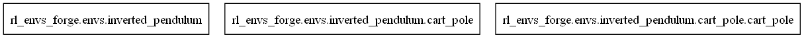
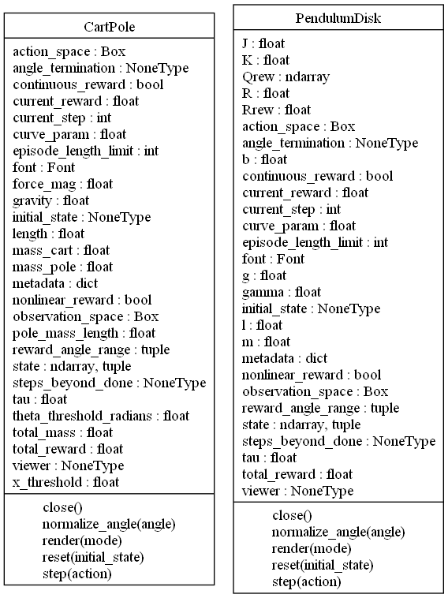

# Inverted pendulum environments

These environments ask a controller to keep an unstable pendulum upright.
Both accept a continuous control input and let you choose the starting state,
reward shape, integration timestep, and episode length.

| Environment | System | Observation | Action |
| --- | --- | --- | --- |
| [CartPole](cart_pole/README.md) | A pole balanced on a cart moving along a track. | Cart position and velocity, pole angle and angular velocity. | Horizontal force. |
| [PendulumDisk](pendulum_disk/README.md) | A motor-driven disk with an off-center weight. | Angle and angular velocity. | Motor voltage. |

Actions are NumPy arrays with shape `(1,)`, dtype `float32`, and values in
`[-3, 3]`. Angles are in radians, with zero representing upright. Each step
returns `(observation, reward, terminated, truncated, info)`.

Start with `reset(seed=0)` for a repeatable initial state. To choose a state,
use `reset(initial_state=...)` or `reset(options={"initial_state": ...})`.
Both environments provide Pygame rendering through `render()` and a
Matplotlib view through `render(mode="matplotlib")`.

The individual READMEs describe reward settings and episode endings.

## Diagrams

