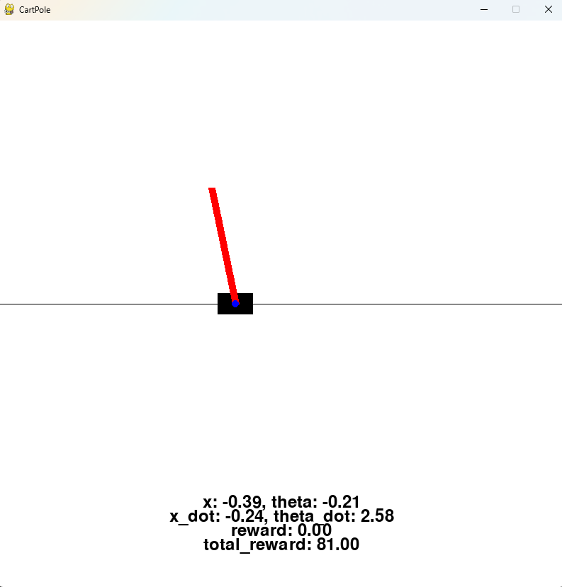

# CartPole

Balance a pole by applying force to the cart beneath it. The observation is
`[cart_position, cart_velocity, pole_angle, pole_angular_velocity]`, with zero
angle representing an upright pole.

## Getting started

```python
from rl_envs_forge.envs.inverted_pendulum.cart_pole.cart_pole import CartPole

env = CartPole(tau=0.02)
state, info = env.reset(seed=0)
env.action_space.seed(0)

for _ in range(1000):
    action = env.action_space.sample()
    state, reward, terminated, truncated, info = env.step(action)
    if terminated or truncated:
        break

env.close()
```

`tau` is the integration timestep in seconds. Actions are horizontal forces
between `-3` and `3`, supplied as `float32` NumPy arrays with shape `(1,)`.
For example, `np.array([0.5], dtype=np.float32)` applies a force of `0.5`.

## Starting states

Without a specified state, reset samples each component uniformly from
`[-0.01, 0.01]`. A seed repeats that sample; an unseeded reset continues the
random stream.

```python
import numpy as np

state, info = env.reset(
    seed=0,
    options={"initial_state": np.array([0.0, 0.0, 0.05, 0.0])},
)
```

You can also pass `initial_state` to the constructor to use it on every reset,
or directly to `reset(initial_state=...)` for one episode.

## Rewards and episode endings

By default, the reward is one when the angle is inside `reward_angle_range`
(default `(-0.1, 0.1)`) and zero otherwise. Set `continuous_reward=True` for a
reward that decreases linearly with the absolute pole angle. Adding
`nonlinear_reward=True` uses an exponential curve shaped by `reward_decay_rate`.

The episode terminates if the cart leaves `[-2.4, 2.4]` or the pole angle
leaves `[-0.2, 0.2]`. `angle_termination` can impose a tighter angle limit.
`episode_length_limit` defaults to 1000 steps; reaching it returns
`truncated=True`. Stop on either ending flag, as in the example.

`info` includes the cart and angular accelerations (`x_acc`, `theta_acc`),
applied `force`, and step count (`steps`).

## Rendering

Call `env.render()` inside the loop to open a Pygame view, or use
`env.render(mode="matplotlib")` for a plot. Close the environment when finished.


