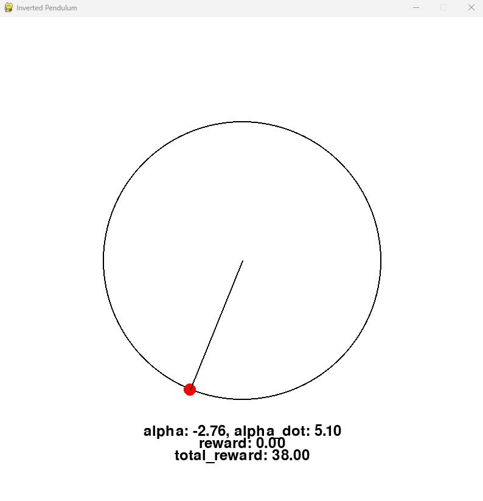

# PendulumDisk

Control a motor-driven disk with a weight attached away from its center. The
observation is `[angle, angular_velocity]`, with zero angle representing the
weight balanced above the pivot.

## Getting started

```python
from rl_envs_forge.envs.inverted_pendulum.pendulum_disk.pendulum_disk import PendulumDisk

env = PendulumDisk(tau=0.005)
state, info = env.reset(seed=0)
env.action_space.seed(0)

for _ in range(1000):
    action = env.action_space.sample()
    state, reward, terminated, truncated, info = env.step(action)
    if terminated or truncated:
        break

env.close()
```

`tau` is the integration timestep in seconds. Actions are motor voltages
between `-3` and `3`, supplied as `float32` NumPy arrays with shape `(1,)`.
For example, `np.array([0.5], dtype=np.float32)` supplies `0.5` volts.

## Starting states

Reset samples both state components uniformly from `[-0.01, 0.01]` unless you
provide a state. Pass a seed to repeat the sample, or omit it to continue the
random stream.

```python
import numpy as np

state, info = env.reset(
    seed=0,
    options={"initial_state": np.array([0.05, 0.0])},
)
```

Set `initial_state` in the constructor for a fixed start on every reset, or
use `reset(initial_state=...)` to choose the start of one episode.

## Rewards and episode endings

The default reward is one inside `reward_angle_range` (default `(-0.2, 0.2)`)
and zero outside it. With `continuous_reward=True`, the reward decreases
linearly from one at upright to zero at an absolute angle of pi. Adding
`nonlinear_reward=True` uses an exponential curve shaped by `reward_decay_rate`.

Angles are wrapped to `[-pi, pi]`. The episode terminates if angular velocity
leaves `[-15*pi, 15*pi]`, or if the absolute angle exceeds a supplied
`angle_termination`. `episode_length_limit` defaults to 1000 steps and returns
`truncated=True` when reached. Stop on either ending flag.

`info` contains angular acceleration (`alpha_dot_dot`), the input (`force`),
and the step count (`steps`).

## Rendering

Call `env.render()` inside the loop for a Pygame view, or use
`env.render(mode="matplotlib")` for a plot. Close the environment when finished.


