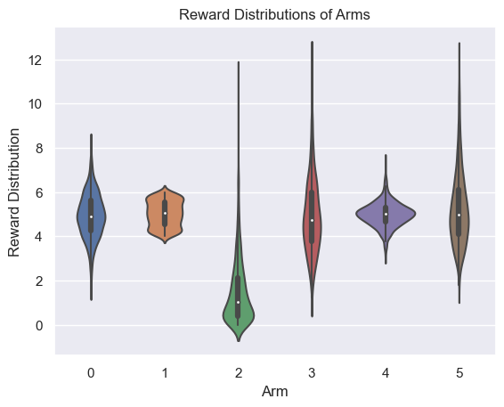
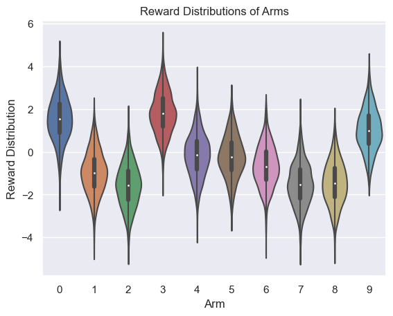
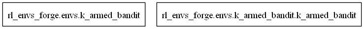
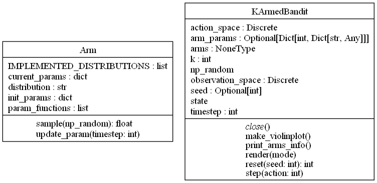

# KArmedBandit

Choose an arm and receive a reward from its distribution. Arms can use different
distributions, and their parameters can change over time to model a
nonstationary bandit.

## Getting started

```python
from rl_envs_forge.envs.k_armed_bandit.k_armed_bandit import KArmedBandit

bandit = KArmedBandit(k=10)
observation, info = bandit.reset(seed=0)
action, reward, terminated, truncated, info = bandit.step(1)
```

Actions are arm indices from `0` to `k - 1`. By default, every arm has a normal
reward distribution with a randomly sampled mean and standard deviation one.
`step()` returns the chosen arm as its first value, while `reset()` returns zero.
The reward is the useful feedback for a bandit policy.

Each pull returns `terminated=True` and `truncated=False`. For a sequence of
pulls from the same bandit, keep calling `step()` without resetting. A reset
rebuilds the arms and restarts the timestep used by parameter schedules.

## Choosing distributions

Pass an `arm_params` dictionary keyed by arm index. Any arms you leave out use
the default normal distribution.

```python
bandit = KArmedBandit(
    k=3,
    arm_params={
        0: {"distribution": "normal", "mean": 5, "std": 1},
        1: {"distribution": "uniform", "low": 4, "high": 6},
        2: {"distribution": "exponential", "scale": 1.5},
    },
)
bandit.reset(seed=0)
```

| Distribution | Parameters |
| --- | --- |
| `normal` | `mean`, `std` |
| `uniform` | `low`, `high` |
| `exponential` | `scale` |
| `gamma` | `shape`, `scale` |
| `beta` | `a`, `b` |
| `logistic` | `loc`, `scale` |
| `weibull` | `a` |
| `lognormal` | `mean`, `sigma` |

Gamma and beta require both parameters shown; Weibull requires `a`. For the
lognormal distribution, `mean` and `sigma` describe the underlying normal
distribution.



## Changing parameters over time

A parameter function returns an offset from the arm's initial value. After
each pull, every arm updates its scheduled parameters using the total number
of pulls, even if that arm was not selected. The updated values apply to the
next pull.

```python
def mean_shift(timestep):
    return 0.1 * timestep


bandit = KArmedBandit(
    k=2,
    arm_params={
        0: {
            "distribution": "normal",
            "mean": 0,
            "std": 1,
            "param_functions": [
                {"function": mean_shift, "target_param": "mean"},
            ],
        },
    },
)
bandit.reset(seed=0)

for _ in range(20):
    action, reward, terminated, truncated, info = bandit.step(0)
```

Choose functions that keep distribution parameters valid, such as a
nonnegative standard deviation.

## Resets and rendering

Use `reset(seed=0)` to repeat a reward sequence for the same sequence of arms.
Calling `reset()` without a seed continues sampling from the current random
stream, so the default arm means are sampled again.

```python
bandit.render(mode="print")
bandit.render(mode="violin_plot")
```

The default render mode is `"violin_plot"`. It samples each arm to draw its
distribution, which also advances the reward RNG. To repeat an experiment,
render at the same points in each run or reset with a seed before collecting
rewards.



## Diagrams



