# Labyrinth

Navigate a generated maze from the start cell to the target. Rooms and corridors
can vary between episodes, or you can keep a maze fixed while comparing policies.

## Table of contents

- [Getting started](#getting-started)
- [Observations and actions](#observations-and-actions)
- [Choosing a maze](#choosing-a-maze)
- [Playing manually](#playing-manually)
- [Maze examples](#maze-examples)
- [How corridor settings affect the layout](#how-corridor-settings-affect-the-layout)
- [UML diagrams](#uml-diagrams)
  - [Packages](#packages)
  - [Classes](#classes)

## Getting started

```python
from rl_envs_forge.envs.labyrinth.labyrinth import Labyrinth

env = Labyrinth(20, 20, seed=0)
observation, info = env.reset(seed=0)
env.action_space.seed(0)

for _ in range(1000):
    action = env.action_space.sample()
    observation, reward, terminated, truncated, info = env.step(action)
    quit_requested, _ = env.render()
    if terminated or truncated or quit_requested:
        break

env.close()
```

Leave out `env.render()` and the quit flag when running without a window.
Labyrinth has no built-in episode length limit, so choose a horizon for your
experiment if a policy might never reach the target.

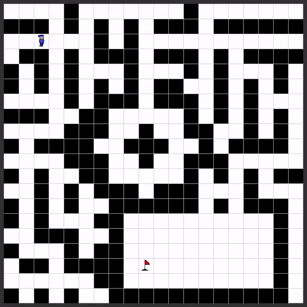

## Observations and actions

Actions are up (`0`), right (`1`), down (`2`), and left (`3`), also available
through `Action` in `labyrinth.constants`. An invalid move leaves the player
in place. The default reward is `-0.01` for a move, `-1` for a collision, and
`10` for reaching the target, which terminates the episode.

The observation is a grid with cell values defined in `constants.py`:

| Value | Cell |
| --- | --- |
| `0` | Wall |
| `1` | Path |
| `2` | Target |
| `3` | Start marker, when present |
| `4` | Player |

By default, the full maze is visible. Set `state_vision_range=n` for a square
observation centered on the player with shape `(2*n + 1, 2*n + 1)`. Cells beyond
the maze boundary appear as walls.

## Choosing a maze

Generated layouts need at least 10 rows and 10 columns. You can choose the room
count, room shapes, amount of space devoted to rooms, and corridor algorithm:

```python
env = Labyrinth(
    30,
    30,
    maze_nr_desired_rooms=5,
    maze_global_room_ratio=0.4,
    room_types=["rectangle", "oval"],
    maze_corridor_algorithm="prim",
    seed=0,
)
```

For more variation, use `maze_nr_desired_rooms_range`,
`maze_global_room_ratio_range`, and `room_access_points_range` instead of fixed
values. The [maze README](maze/README.md) explains the room shapes and corridor
settings illustrated below.

`reset(seed=0)` regenerates the maze for that seed. `reset()` advances the maze
seed to generate another layout. To start again on the current layout, use
`reset(same_seed=True)` or `reset(options={"same_seed": True})`.

You can supply `maze_layout_predetermined` instead of generating a layout.
Its shape determines the full observation shape. Start and target positions
are set manually after each reset; cell markers are not interpreted for you:

```python
import numpy as np

env = Labyrinth(maze_layout_predetermined=np.ones((10, 12), dtype=np.uint8), seed=0)
env.reset(seed=0)
env.maze.target_position = (1, 3)
env.set_state((1, 1))
observation = env.state
observation, reward, terminated, truncated, info = env.step(1)
```

Choose distinct traversable cells inside the layout. Set both positions before
reading local observations or taking actions. The layout remains available as
`env.maze.grid`; copy your input first if you plan to edit that grid separately.
Full observations show the supplied grid without unset player/target markers.
Stepping or rendering before both positions are set raises a diagnostic
`RuntimeError`. Local observations also require both positions: constructing a
local-view environment is supported, but a supplied-layout reset clears the
positions and raises this diagnostic when it tries to return a local view.
Reapply the manual setup after resetting; positions are never inferred from
cell markers.

## Playing manually

```python
from rl_envs_forge.envs.labyrinth.labyrinth import Labyrinth

env = Labyrinth(20, 20, seed=0)
env.human_play(print_info=True, animate=True)
env.close()
```

Use the arrow keys to move and Escape to leave. The [display](display/README.md)
and [entities](entities/README.md) READMEs describe the renderer and player.

## Maze examples

<table>
<tr>
    <th colspan="2">Corridor algorithm: prim</th>
</tr>
<tr>
<td>
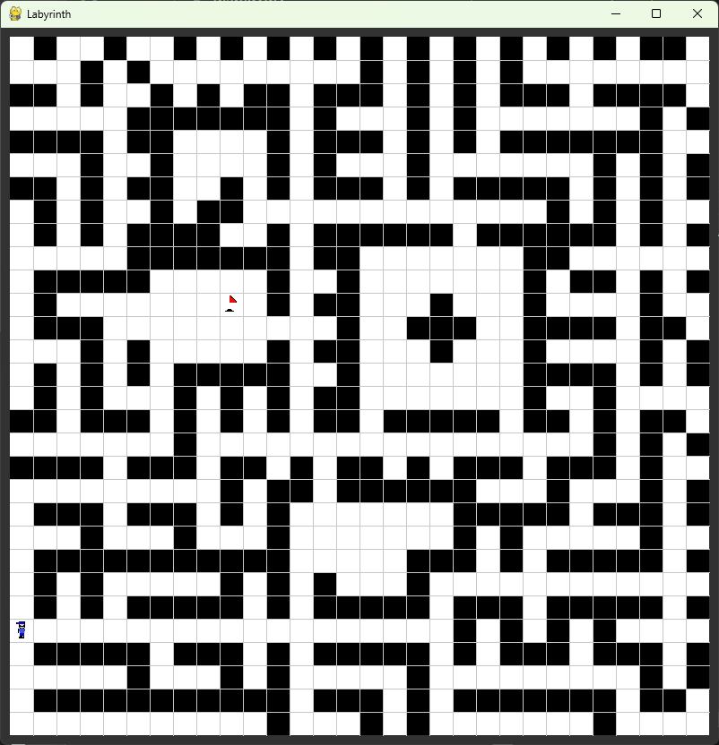
</td>
<td>
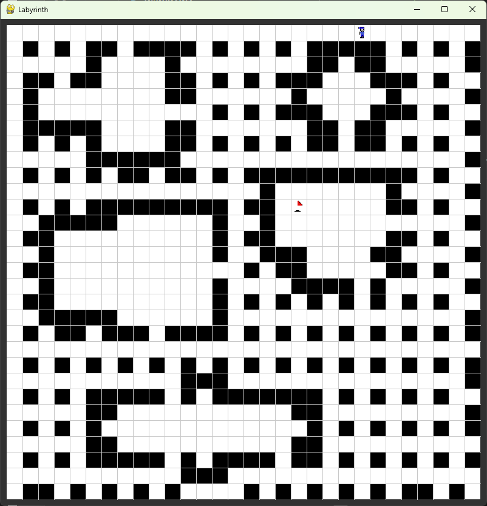
</td>
</tr>

<tr>
<td>
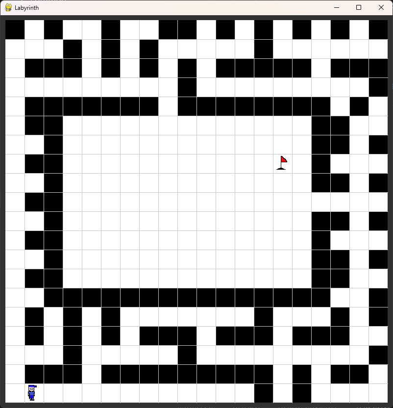
</td>
<td>
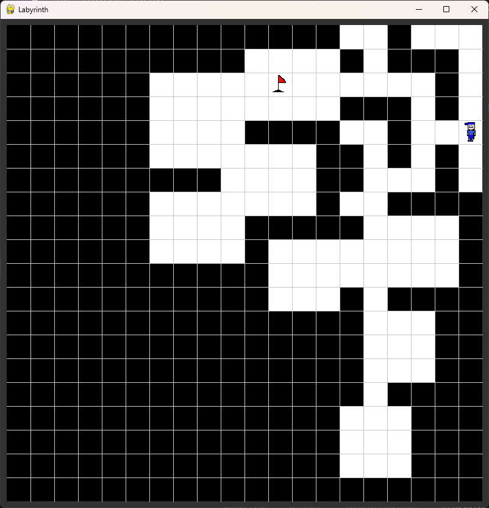
</td>
</tr>

<tr>
    <th colspan="2">Corridor algorithm: astar</th>
</tr>
<tr>
<td>
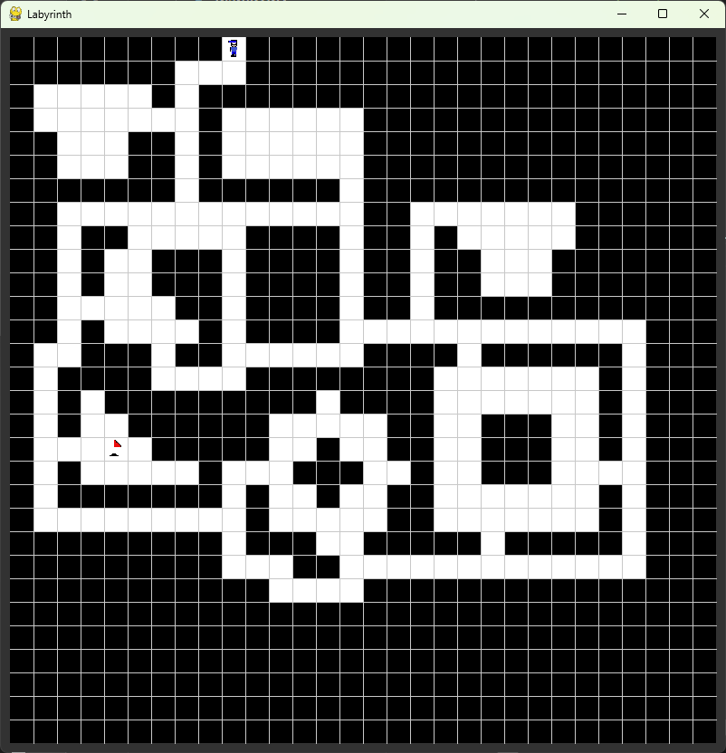
</td>
<td>
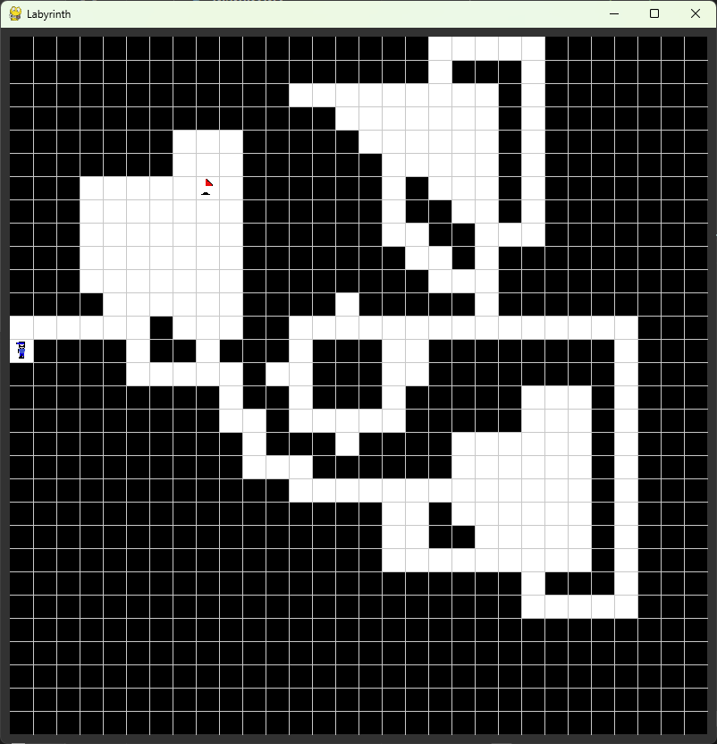
</td>
</tr>

<tr>
    <th colspan="2">Corridor algorithm: gbfs</th>
</tr>
<tr>
<td>
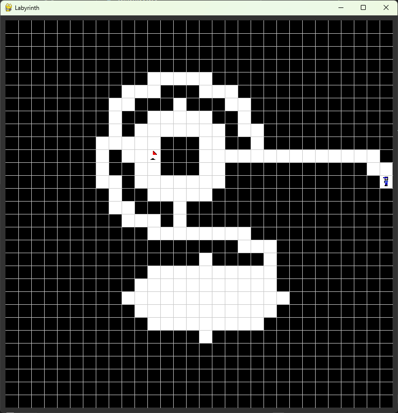
</td>
<td>
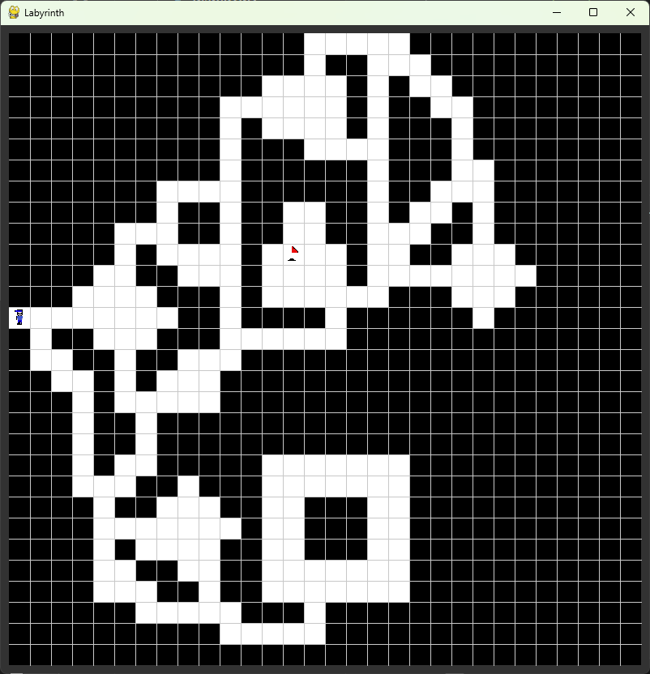
</td>
</tr>
</table>

## How corridor settings affect the layout

<table>
<tr>
    <th colspan="3">Corridor algorithm: prim</th>
</tr>
<tr>
    <th colspan="1">post_process:False, grid_connect:False</th>
    <th colspan="1">post_process:True, grid_connect:False</th>
    <th colspan="1">post_process:True, grid_connect:True</th>
</tr>
<tr>
<td>
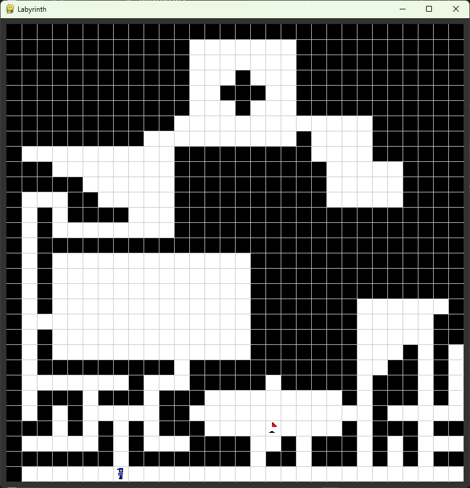
</td>
<td>
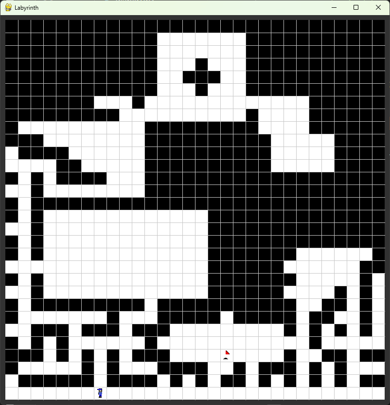
</td>
<td>
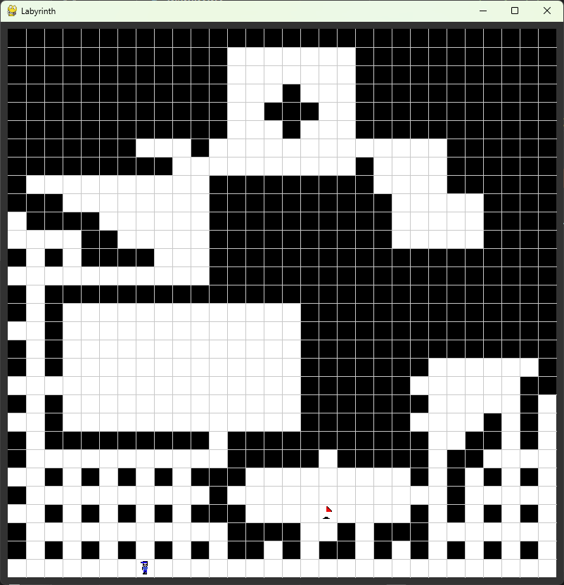
</td>
</tr>

<tr>
    <th colspan="2">Corridor algorithm: astar</th>
</tr>
<tr>
    <th colspan="1">sort_access_points:False</th>
    <th colspan="1">sort_access_points:True</th>
</tr>
<tr>
<td>
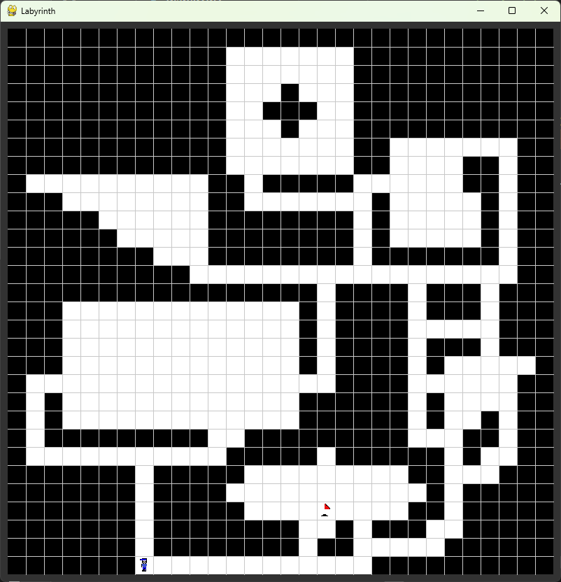
</td>
<td>
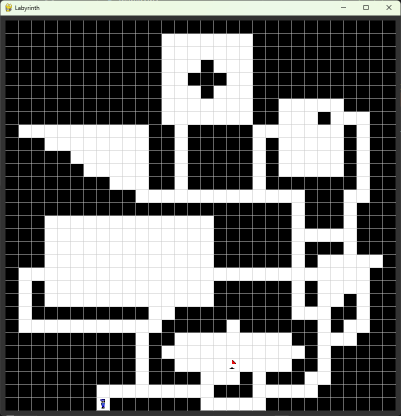
</td>
</tr>

<tr>
    <th colspan="2">Corridor algorithm: gbfs</th>
</tr>
<tr>
    <th colspan="1">sort_access_points:False</th>
    <th colspan="1">sort_access_points:True</th>
</tr>
<tr>
<td>
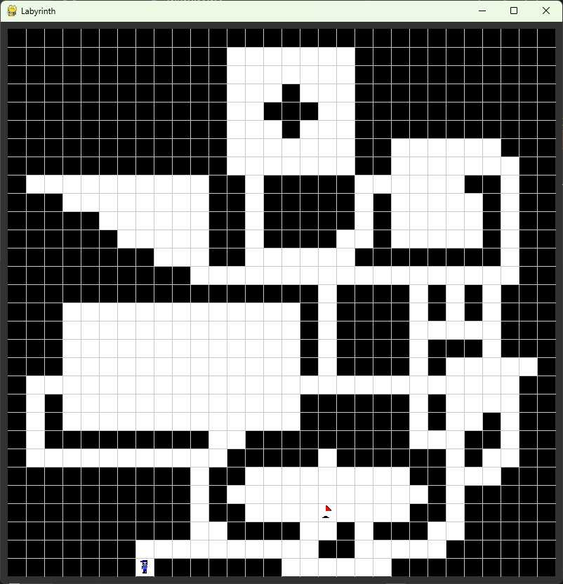
</td>
<td>
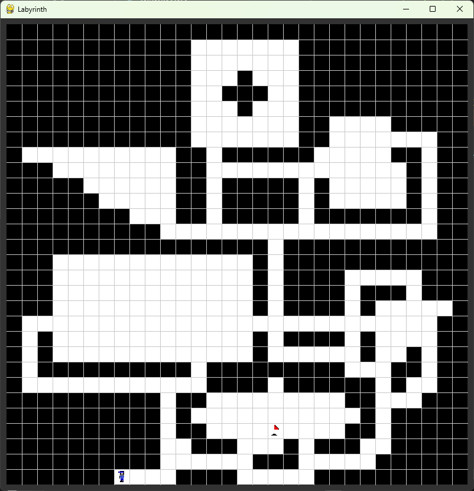
</td>
</tr>

</table>

## UML diagrams

### Packages

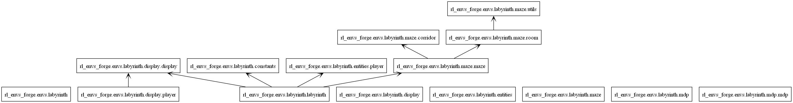

### Classes

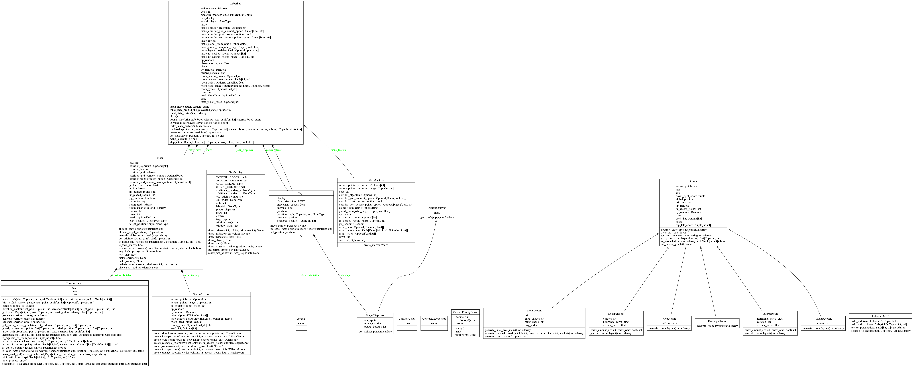
