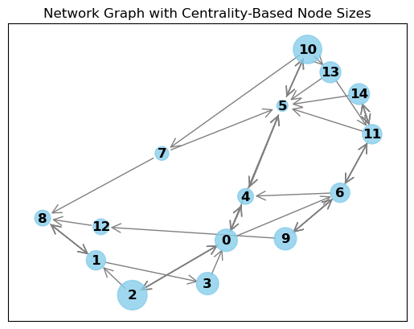
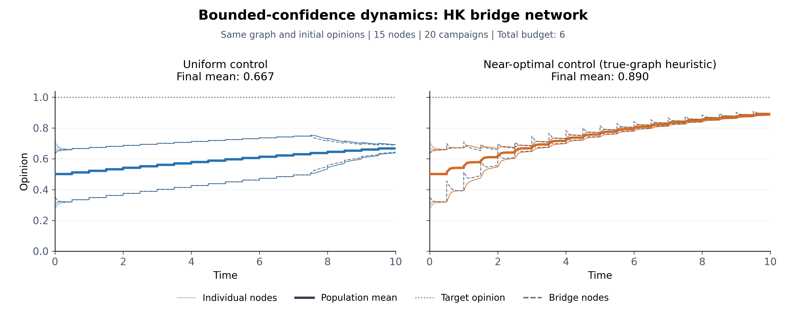

# NetworkGraph

NetworkGraph models how opinions spread through a network. At each step, you choose
how much control to apply to each node. Control moves opinions toward a target,
then the network evolves according to the selected dynamics model.

## Getting started

```python
from rl_envs_forge.envs.network_graph.network_graph import NetworkGraph

env = NetworkGraph(num_agents=10, max_u=0.1, seed=0)
opinions, info = env.reset(seed=0)
env.action_space.seed(0)

for _ in range(100):
    action = env.action_space.sample()
    opinions, reward, terminated, truncated, info = env.step(action)
    if terminated or truncated:
        break

env.close()
```

The observation is a vector of `num_agents` opinions. The action is a vector of
the same length, with each entry between zero and that node's `max_u`. You can
set `max_u` and `desired_opinion` per node by passing arrays instead of scalars.
`control_resistance` takes an array or `None`.

## Choosing a network

By default, the environment generates a random graph. Use
`graph_connection_distribution="uniform"`, `"normal"`, or `"exponential"` to
choose how connection probabilities are sampled. `graph_connection_params`
accepts `mean` and `std` for the normal distribution, or `scale` for the
exponential distribution. Set `bidirectional_prob=1.0` for an undirected graph.

For a Barabasi-Albert network, use `graph_model="barabasi_albert"`. `ba_m` sets
the number of attachments for each new node, and `ba_prune_max_frac` controls
how many directed edges may be removed. The resulting influence matrix is
normalized by row. `ba_connectivity` selects the acceptance rule: `"paper"`,
`"no_singleton_sink"` (the default), or `"strong"`.

You can also supply a square adjacency matrix. Its size determines the number
of agents:

```python
import numpy as np
from rl_envs_forge.envs.network_graph.network_graph import NetworkGraph

adjacency = np.array([
    [0.0, 1.0, 0.0, 1.0],
    [1.0, 0.0, 1.0, 0.0],
    [0.0, 1.0, 0.0, 1.0],
    [1.0, 0.0, 1.0, 0.0],
])

env = NetworkGraph(
    connectivity_matrix=adjacency,
    initial_opinions=np.array([0.1, 0.3, 0.6, 0.8]),
    desired_opinion=1.0,
    max_u=0.1,
    t_campaign=1.0,
    t_s=0.1,
)
opinions, info = env.reset()
```

In the dynamics, `adjacency[i, j]` controls how node `j` contributes to node `i`.
Supplied matrices keep their weights unless `use_weighted_edges=True`, which
replaces entries equal to one with samples from `weight_range`. This option
also samples weights for Barabasi-Albert graphs before row normalization.

## Opinion dynamics

Choose a model with `dynamics_model`:

| Model | Behavior | Main settings |
| --- | --- | --- |
| `laplacian` (also `degroot`) | Continuous consensus using the graph Laplacian. | `t_s` |
| `coca` | Neighbor influence varies with the node's current opinion. | `t_s` |
| `friedkinjohnsen` | Mixes social influence with a fixed prejudice vector. | `fj_lambda`, `fj_prejudice` |
| `hegselmannkrause` | Averages neighbors whose opinions are close enough. | `hk_epsilon`, `hk_include_self` |
| `nonlinearinfluence` | Uses a saturating influence function. | `nonlinear_beta`, `t_s` |
| `repulsion` | Attracts similar opinions and pushes distant ones apart. | `repulsion_epsilon`, `repulsion_strength`, `t_s` |

Each environment step applies control once, then runs propagation for
`t_campaign` using intervals of `t_s`. `t_s` must be positive and divide
`t_campaign` evenly. The Friedkin-Johnsen and Hegselmann-Krause models apply a
discrete update at each interval.

For Friedkin-Johnsen averaging, supply a matrix whose rows sum to one. You can
prepare one with `normalize_adjacency_matrix` from `graph_utils`. If
`fj_prejudice` is omitted, it is set to the initial opinions of each episode;
a supplied prejudice vector stays fixed across resets.

## Rewards and episode endings

The default reward penalizes distance from the target and the amount of control:

```text
reward = -sum(abs(desired_opinion - opinions)) - control_beta * sum(action)
```

`normalize_reward=True` divides this value by the number of agents.
`use_delta_shaping=True` adds a progress term weighted by `delta_lambda`.
`terminal_reward` adds a bonus for convergence before the step limit.

An episode terminates when the mean opinion is within `opinion_end_tolerance`
of the target. Set `terminate_when_converged=False` to keep running until
`max_steps`, which truncates the episode.

For a per-node target vector, control uses each node's target, while reward
distances and the convergence check use the mean target.

`budget` tracks spending: it does not restrict actions or end an episode.
`info` includes `total_spent`, `remaining_budget` when a budget is set, and
`intermediate_states` for the propagation between control steps. Keep actions
within `action_space`: dynamics clips controls to the allowed range, while
reward costs and spending use the action you supplied.

## Repeating an experiment

The constructor's `seed` controls graph generation and initial opinion sampling.
Two environments built with the same seed and settings start alike.

`reset(seed=0)` restarts opinion sampling on the current graph. Repeating that
reset gives the same opinions; `reset()` continues the random stream. The graph,
Laplacian, and centralities stay fixed. Because construction also draws random
numbers for the graph, a reset seed does not necessarily reproduce the opinions
seen immediately after construction.

If `initial_opinions` is supplied, resets use that vector. To sample opinions
instead, call `reset(randomize_opinions=True)` or
`reset(options={"randomize_opinions": True})`.

## Rendering

```python
fig = env.render(mode="matplotlib", seed=0)
centrality_fig = env.render(mode="centralities")
env.render(mode="human")
```

The first two calls return Matplotlib figures; `"human"` prints the current
opinions and spending. Try `layout_try=1` for another graph layout, or
`randomize_layout=True` to sample a layout. Layout changes leave the simulation
unchanged.



## Example trajectories

Opinion trajectories under uniform and near-optimal control,
starting from the same network and initial opinions.

